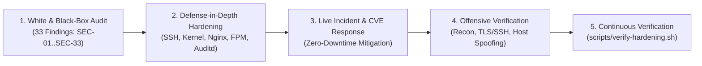

# Linux Server Hardening & SecOps Lab — Case Study

English · [Español](#español)

Hands-on cybersecurity case study documenting the **auditing, defense-in-depth hardening, offensive verification (black-box pentesting), and live incident/CVE response** of a multi-tenant Linux VPS (Ubuntu LTS, 2 GB RAM) hosting isolated web workloads without container overhead.

All IP addresses, domains, service routes, and tenant identifiers in this repository are **sanitized placeholders** (`203.0.113.10`, `example.com`, `tenant_a`, `/etc/webapp/`).

---

## 1. Security Engineering & Purple Team Workflow



---

## 2. Case Studies, Audits & Incident Reports

| Document / Report | Focus Area | Key Technical Takeaways |
|---|---|---|
| **[`docs/SECURITY-AUDIT-MATRIX.md`](docs/SECURITY-AUDIT-MATRIX.md)** | **White-Box & Perimeter Audit (`SEC-01` to `SEC-33`)** | 5-phase remediation matrix: fixing critical port-80 catch-all credential leaks (`SEC-18`), cross-tenant symlink traversal (`SEC-01`), `X-Forwarded-For` rate-limit bypass (`SEC-02`), atomic TOTP anti-replay (`SEC-07`), and `/proc` telemetry privilege escalation (`SEC-27`). |
| **[`docs/PENTEST-VERIFICATION.md`](docs/PENTEST-VERIFICATION.md)** | **Black-Box Reconnaissance & Active Testing** | External TCP port sweep, OpenSSH cryptographic algorithm audit (`curve25519-sha256`, `ssh-ed25519`, `chacha20-poly1305`), TLS 1.2/1.3 verification, `Host` header spoofing tests (`HTTP 444`), and CVSS-prioritized application findings. |
| **[`incidents/INC-001-nginx-rewrite-ratelimit-oom/`](incidents/INC-001-nginx-rewrite-ratelimit-oom/README.md)** | **P0 Patch: Nginx `rewrite` vs. `limit_req` & OOM Containment** | Root-cause analysis of why `limit_req` in Nginx's `preaccess` phase is bypassed when placed inside a `location` block that executes `rewrite ... last`, plus PHP-FPM memory capping (`256M`) and `diff.patch` applied with zero downtime. |
| **[`incidents/INC-002-php-fpm-rce-mitigation/`](incidents/INC-002-php-fpm-rce-mitigation/README.md)** | **Emergency CVE Response (`CVE-2026-109618` / `109619` / `115560`)** | Zero-downtime mitigation of critical PHP-FPM RCE and cross-request memory disclosure vulnerabilities, disabling `session.upload_progress.enabled` and verifying per-tenant FPM socket isolation. |
| **[`incidents/INC-003-openssh-sshole-forensic-audit/`](incidents/INC-003-openssh-sshole-forensic-audit/README.md)** | **Forensic Triage of OpenSSH `CVE-2026-123158` (`*sshole`)** | Empirical binary and runtime inspection (`ldd /usr/sbin/sshd`, `sshd -T`, PAM + GNU `glibc` vs. `musl libc`) proving triple-barrier immunity against password-length authentication bypass. |
| **[`docs/ARCHITECTURE.md`](docs/ARCHITECTURE.md)** & **[`docs/RUNBOOK.md`](docs/RUNBOOK.md)** | **Defense-in-Depth Architecture & SecOps Runbook** | Multi-tenant isolation matrix (`open_basedir`, per-tenant Unix users and sockets), systemd unit sandboxing, and standard operating procedures for `fail2ban` and `auditd`. |

---

## 3. Hardened Configuration Baseline & Automation

| Layer | Controls Implemented | Path |
|---|---|---|
| **Automated Audit Script** | Non-destructive Bash script verifying `sshd -T`, `sysctl`, `ufw`, `fail2ban`, `auditd`, Nginx `return 444`, and PHP-FPM pool limits | [`scripts/verify-hardening.sh`](scripts/verify-hardening.sh) |
| **SSH Daemon** | Public-key only (`PasswordAuthentication no`, `KbdInteractiveAuthentication no`), `AllowUsers` allow-list, no TCP forwarding, modern KEX/MACs | [`config/ssh/sshd_config.d/`](config/ssh/sshd_config.d) |
| **Intrusion Prevention** | Fail2ban jails for `sshd`, Nginx auth floods, and scanner bots using `ufw` ban action | [`config/fail2ban/jail.local`](config/fail2ban/jail.local) |
| **Kernel Network Stack** | `tcp_rfc1337=1`, ICMP redirect blocking (IPv4/IPv6), martian packet logging | [`config/sysctl.d/99-security-hardening.conf`](config/sysctl.d/99-security-hardening.conf) |
| **Web Perimeter (Nginx)** | Default `return 444` catch-all, `server_tokens off`, TLS 1.2/1.3, HSTS, CSP, `disable_symlinks if_not_owner`, per-endpoint `limit_req` zones | [`config/nginx/`](config/nginx) |
| **Multi-Tenant PHP-FPM** | Dedicated Unix user & socket per tenant, strict `open_basedir`, `disable_functions` blocking command execution, `ondemand` process manager, memory caps | [`config/php/8.5/fpm/pool.d/`](config/php/8.5/fpm/pool.d) |
| **Systemd Sandboxing** | `NoNewPrivileges=true`, `ProtectSystem=strict`, `ProtectHome=true`, `PrivateTmp=true`, kernel/cgroup protections, `MemoryMax=350M`, `CPUQuota=85%` | [`systemd/`](systemd) |
| **Kernel Auditing (`auditd`)** | Watches on `/etc/shadow`, `/etc/passwd`, `/etc/sudoers`, `/etc/ssh/sshd_config`, credential stores, privilege escalation binaries, and kernel modules | [`config/audit/rules.d/audit.rules`](config/audit/rules.d/audit.rules) |

### Running the automated baseline check
```bash
sudo bash scripts/verify-hardening.sh
```

---

## Español

Caso de estudio práctico de ciberseguridad que documenta la **auditoría (caja blanca y caja negra), el endurecimiento en profundidad (*defense-in-depth*), la verificación ofensiva (pentesting de infraestructura) y la respuesta a incidentes y CVEs en vivo** sobre un servidor Linux Ubuntu LTS de 2 GB de RAM.

1. **Auditoría y Remediación en 5 Fases ([`docs/SECURITY-AUDIT-MATRIX.md`](docs/SECURITY-AUDIT-MATRIX.md))**: matriz completa de **33 hallazgos (`SEC-01` a `SEC-33`)**, detallando el vector técnico, la remediación aplicada y las pruebas de verificación perimetral.
2. **Reconocimiento y Verificación en Caja Negra ([`docs/PENTEST-VERIFICATION.md`](docs/PENTEST-VERIFICATION.md))**: barrido de puertos TCP, auditoría de algoritmos criptográficos en SSH y TLS, pruebas de *Host header spoofing* (`HTTP 444`) y priorización CVSS.
3. **Respuesta a Incidentes y Análisis Forense de CVEs ([`incidents/`](incidents))**:
   - **[`INC-001`](incidents/INC-001-nginx-rewrite-ratelimit-oom/README.md)**: análisis del ciclo de fases de Nginx (`rewrite ... last` frente a `limit_req` en fase `preaccess`), contención de *Out-Of-Memory* en PHP-FPM y parche [`diff.patch`](incidents/INC-001-nginx-rewrite-ratelimit-oom/diff.patch) aplicado sin caída de servicio.
   - **[`INC-002`](incidents/INC-002-php-fpm-rce-mitigation/README.md)**: mitigación de emergencia sin caída de servicio ante vulnerabilidades críticas RCE en PHP-FPM (`CVE-2026-109618`, `CVE-2026-109619`, `CVE-2026-115560`).
   - **[`INC-003`](incidents/INC-003-openssh-sshole-forensic-audit/README.md)**: auditoría forense de binarios y configuración (`ldd`, `sshd -T`, PAM + `glibc`) frente a la vulnerabilidad `*sshole` (`CVE-2026-123158`) en OpenSSH.
4. **Automatización de Auditoría ([`scripts/verify-hardening.sh`](scripts/verify-hardening.sh))**: script en Bash para auditar automáticamente la postura de seguridad del servidor.
